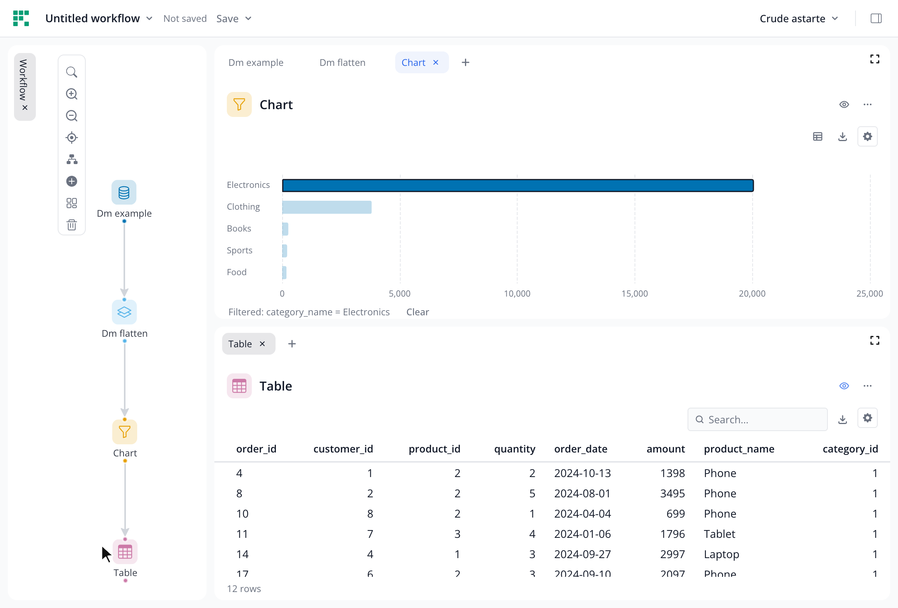
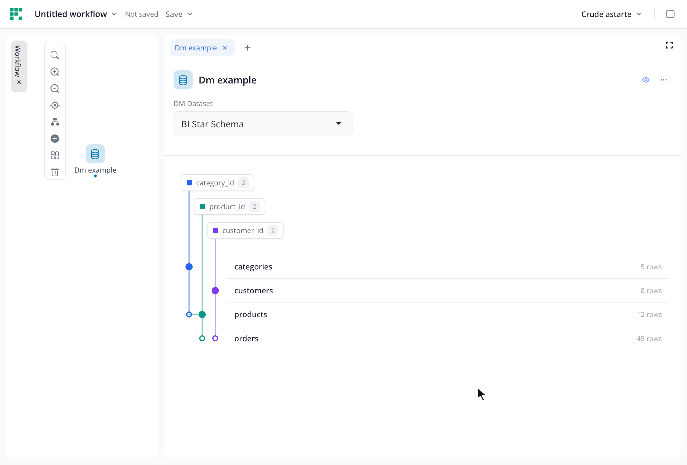

# Work with many tables

Data often comes as several linked tables. This tutorial loads a data model, four tables with key relationships, flattens it into one analysis table, and charts it.

Watch the flow, then follow the steps below:

<video controls muted style="width: 100%; border: 1px solid var(--vp-c-divider); border-radius: 8px;" src="/videos/tutorial-03.webm" poster="/videos/tutorial-03-poster.png"></video>

## Do it yourself

1. Add an "Example data model" block. "BI Star Schema" is selected by default, and the preview draws the model: categories, products, customers and orders, with the key relationships as lines:

   

2. Add a "Flatten dm" block after it. Set "Start from table" to "orders" and leave "Recursive (follow all relationships)" on: the output is one flat table, every order joined with its product, category and customer columns along the keys.
3. Add a "Chart" block after that. In its settings (the gear in the chart's corner), set Category to "category_name", Aggregate to "Sum" and Value to "amount". Under "Interaction", tick "Filter on".
4. Add a "Table" block after the chart. It opens as a tab next to the chart; drag its tab below the chart to see both, and hide the chart's own preview table with the eye in its header. Click a bar in the chart: the table shows the orders behind it, like in the previous tutorial.

The other dm blocks filter, select and pull tables from a model; the [blockr.dm reference](/docs/blocks/blockr.dm) lists them. The same blocks run on lazy database tables: the [DuckDB demo](https://blockr.cloud/app/duckdb-lazy) pages through 100 million rows without ever materializing them.

