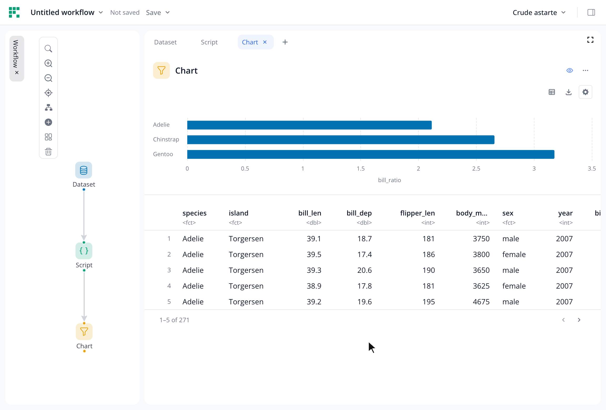
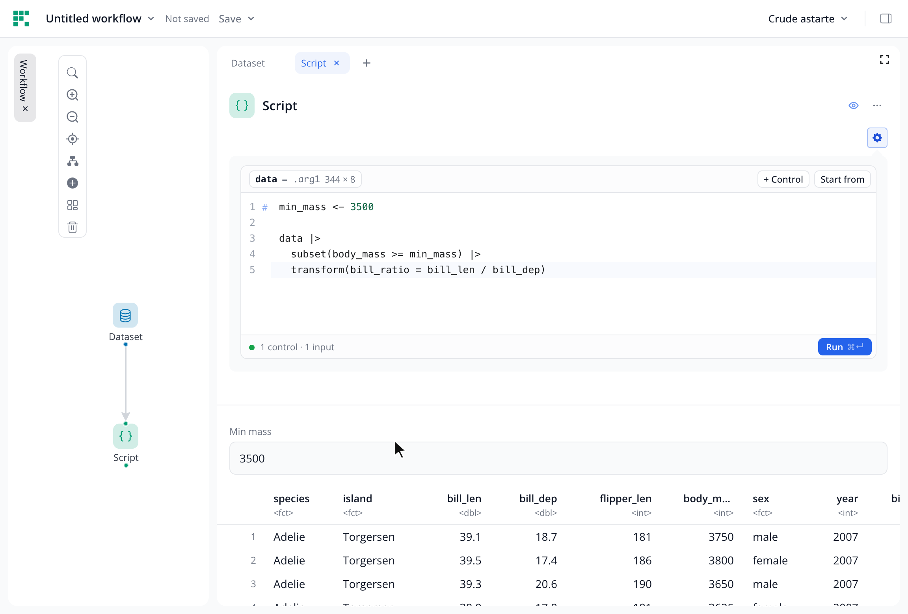

# Custom code

The script block runs an R script as a workflow step. The script reads the upstream data as `data`, and what its last line returns flows downstream. Use it when no block does the transformation you need.



Watch the flow, then follow the steps below:

<video controls muted style="width: 100%; border: 1px solid var(--vp-c-divider); border-radius: 8px;" src="/videos/tutorial-04.webm" poster="/videos/tutorial-04-poster.png"></video>

## Do it yourself

1. Add a "Script" block after a dataset block with "penguins". Its default script keeps the first six rows: `n <- 6`, then `utils::head(data, n)`. The `n` shows up on the block as a number box.
2. Click the gear in the script block's corner. The editor opens with the script. Replace it with:

   ```r
   min_mass <- 3500

   data |>
     subset(body_mass >= min_mass) |>
     transform(bill_ratio = bill_len / bill_dep)
   ```

3. Click "Run" (or Cmd/Ctrl+Enter). The preview keeps the 271 penguins of 3500 g or more and gains a "bill_ratio" column. `min_mass <- 3500` becomes a "Min mass" box on the block:

   

4. Close the gear and add a "Chart" block after the script block. In the chart's settings (its gear), set Category to "species", Aggregate to "Mean" and Value to "bill_ratio".
5. Back on the script block, change "Min mass" to 4500. The chart follows.

A top-level assignment of a plain value (a number, a string, `TRUE`/`FALSE`, a factor) becomes a control on the block. Whoever builds the board writes the script behind the gear; whoever uses it only sees the controls and the result.

If the assistant is turned on ([Install](/install#turn-on-the-assistant)), it can write the script from a description; you review and run it.

If the same script recurs across boards, make it a block of its own: [Create a custom block](05-create-a-block).
